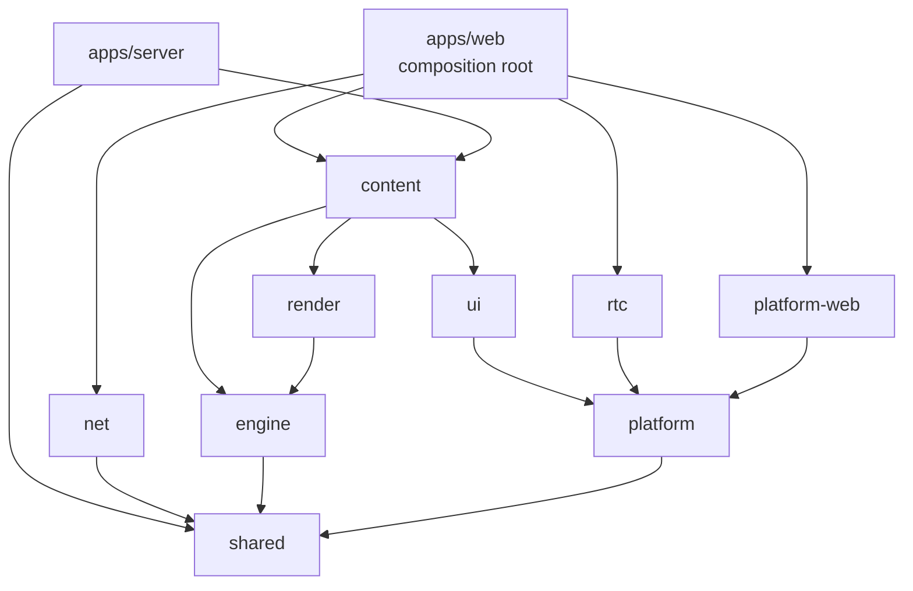
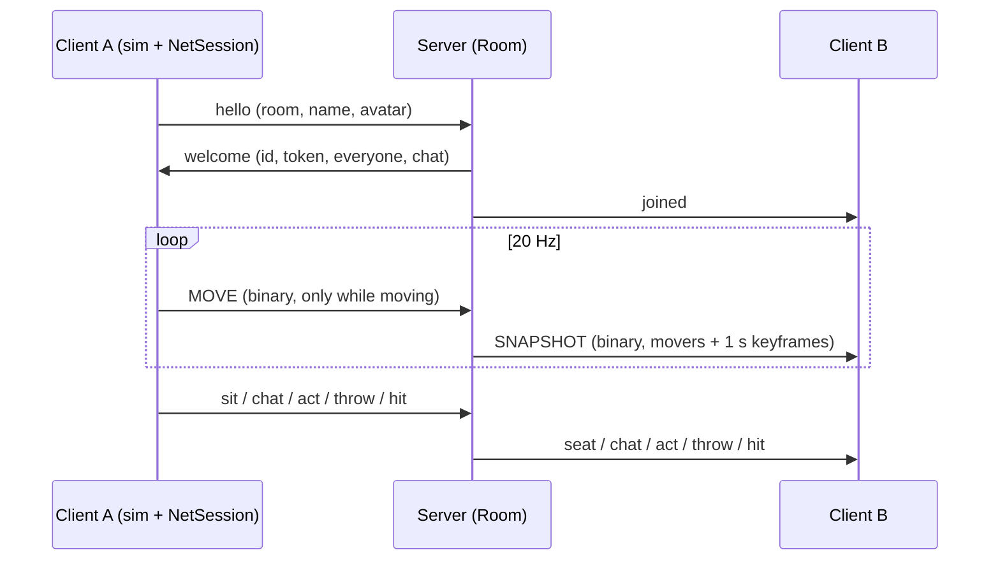
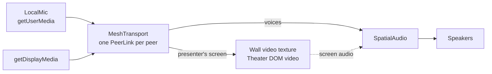
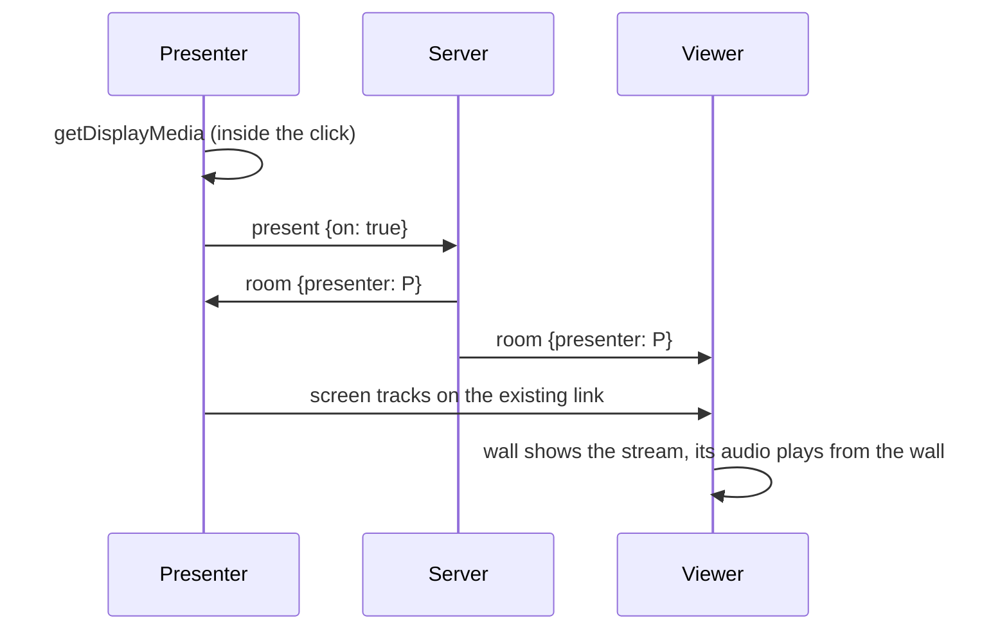
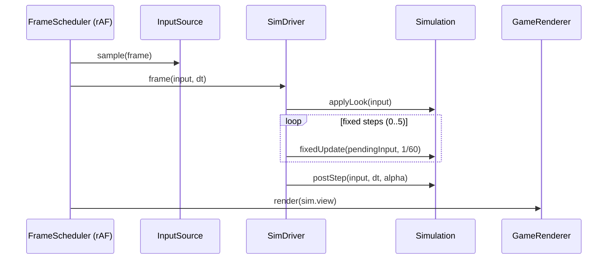

# Architecture

Huddle is a TypeScript monorepo. The simulation is platform-agnostic; everything that touches a
browser API lives behind interfaces in `packages/platform` and is implemented in
`packages/platform-web`. The renderer only reads a `WorldView` published by the engine.

## Packages and dependency direction

Dependencies point downward only. `content` is the plugin layer: it may use every layer below it,
and no layer below imports it (the app injects content data such as palettes and strings).

| Package        | Responsibility                                                                                 | May touch                                |
| -------------- | ---------------------------------------------------------------------------------------------- | ---------------------------------------- |
| `shared`       | protocol, zod schemas, room types + `resolveRoom`, math, RNG, input actions, `Clock`, `Logger` | nothing platform-specific                |
| `engine`       | ECS, fixed-step loop, Rapier physics, character controller, camera rig, seats, `WorldView`     | `shared`, Rapier (WASM runs in Node too) |
| `platform`     | interfaces only + typed `ServiceContainer` + `Capabilities`                                    | types                                    |
| `platform-web` | web implementations of every platform interface                                                | all browser APIs                         |
| `render`       | three.js scene, materials, avatars, post-FX, quality                                           | WebGL via the injected canvas            |
| `net`          | `RealtimeClient` over any `SocketLike`, snapshot interpolation, clock sync, session resume     | `shared`                                 |
| `rtc`          | `MediaTransport` (WebRTC mesh), microphone, spatial audio graph, speaking detection            | platform media interfaces, `shared`      |
| `ui`           | React HUD overlay, Zustand stores                                                              | DOM for rendering only                   |
| `content`      | rooms (JSON), prop catalog, palettes, emotes, items, i18n, activity modules                    | everything below                         |

Purity is enforced by ESLint (`no-restricted-globals`, `no-restricted-imports`) per folder. The
browser layers (`render`, `rtc`, `ui`, `content`) get every platform object (`AudioContext`,
`RTCPeerConnection`, media devices, sockets) through `@huddle/platform`, never from globals.

## Multiplayer

- **Server (`apps/server/src/realtime`):** `RoomManager` creates rooms on first use; a `Room`
  validates every message (zod, rate limits, movement budget), arbitrates seats and the hand
  queue, keeps chat history and host settings, and holds dropped sessions for 45 s.
- **Client (`packages/net`):** `RealtimeClient` (hello, reconnect with backoff and resume, clock
  sync, throttled movement) and per-player `PoseBuffer`s drawn 100 ms in the past.
- **Engine:** remote people are ordinary players with a `Remote` component: `stepRemote` copies
  the network pose (and moves their capsule, so throws hit them), `SeatSystem.placeInSeat` seats
  them where the server says. Seat claims go through a `SwitchableSeatArbiter`: local offline,
  `NetSeatArbiter` online. Replayed throws are cosmetic; the thrower reports hits.
- **App:** `NetSession` bridges the client and the simulation (ids, events both ways, HUD room
  state); `RoomFlow` handles the lobby, offline play and invite links.

Load: `pnpm test` runs a 50-client swarm against a real server; `pnpm bots` does the same against
any server. The Playwright e2e runs three browsers in one room.

## Voice and screen sharing

Media goes peer to peer over WebRTC; the server relays signaling between the room's media peers
and decides who presents ([protocol](PROTOCOL.md#media)).

- **`LocalMic`:** capture with echo cancellation, noise suppression and auto gain (each
  toggleable), mute and push-to-talk by disabling the track (peers get silence, Opus DTX sends
  almost nothing), device switching and hot-plug recovery. A cloned track feeds a level meter that
  keeps working while muted (lobby mic test, "you are muted" hint).
- **`MeshTransport` / `PeerLink`:** perfect negotiation, tracks attached once and swapped with
  `replaceTrack`, stream announcements, ICE restarts and link stats. The screen's bitrate splits a
  6 Mbps upload budget across viewers (0.5 to 2.5 Mbps each); `contentHint` and
  `degradationPreference` keep text sharp or motion smooth. An SFU would implement the same
  `MediaTransport` interface.
- **`SpatialAudio`:** per source `MediaStreamAudioSourceNode → GainNode (per-person volume) →
PannerNode (HRTF) → master (deafen) → compressor`, with an analyser per source for speaking
  detection (RMS with hysteresis). Chromium only feeds remote WebRTC audio into Web Audio while a
  media element plays the stream, so every source also gets a muted `<audio>` sink
  (`MediaElementFactory.attachAudioSink`).
- **Voice modes (`voiceRoute`):** `global` (no distance falloff; direction still pans),
  `proximity` (inverse falloff: full volume within 1.4 m, about a fifth of it at 5 m) and
  `zones`, the default: people in the same global zone of the room (the meeting area) hear each
  other at full volume, everyone else fades with distance.
- **App:** `VoiceSession` owns the mesh of the online room (rebuilt when the session id changes),
  puts the listener at the local avatar's head facing where the camera looks, places each voice at
  its avatar's head, and drives the speaking ring and muted mark on name tags, the people panel
  and the mouth flap. `LocalVoice` holds mute, deafen and push-to-talk and the HUD's microphone
  state. `ScreenShare` runs the presenter flow:

A presenter whose capture may contain the app itself sees a static card on their own wall
instead of a mirror tunnel. Viewers see a "connecting" card until the picture arrives. Theater
Mode binds a second DOM `<video>` to the same stream (crisper than the texture), pauses texture
uploads, plays the screen audio without distance falloff, and offers zoom and pan, volume and
browser fullscreen (the video's own player on iPhone).

Echo: Chrome cancels everything the browser plays on the default output device, Web Audio
included. Picking another speaker in Settings may weaken that (Chromium issue 40252911).

## Engine (`packages/engine`)

`Simulation` owns the ECS world and wires small systems together; each one is testable on its own
in Node (Rapier's WASM runs there too).

| Piece                              | What it does                                                                   |
| ---------------------------------- | ------------------------------------------------------------------------------ |
| `PlayerRoster`                     | Player entities by id, published `PlayerView`s, spawn/remove events            |
| `LocalController`                  | Local clicks and keys: click-to-walk, sit, interact, aim and throw             |
| `Navigator`                        | A* over a walk grid baked in a worker; straight-line fallback while baking     |
| `SeatSystem` + `SeatArbiter`       | Sit/stand transitions; the arbiter is local offline and the server online      |
| `InteractionSystem`                | Pointer hover (seats, screen, boards, people) and proximity prompts            |
| `ThrowSystem` / `ProjectileSystem` | Cooldowns, caps, release timed to the swing, Rapier projectiles, hits, baskets |
| `ItemSystem` / `LocalPlay`         | Held items and their use, plane pickups; the local hand, shield and plane tilt |
| `SocialSystem`                     | Emotes, flinches, raised hands, the hand queue, "Don't hit me"                 |
| `BotHost` / `BotBrain`             | Seeded office-mates: wander, sit, chat, sip coffee, shoot hoops, throw back    |
| `CameraRig`                        | Follow, first person (zoom in), seated cinema, focus, overview, free fly       |

Everything the host needs to react to (sounds, HUD feed, the network relay) is a typed
`SimEvents` event. The renderer and HUD read the `WorldView` only.

## Playful layer

Throwing, hoops and things in hand, end to end. The rules both ends share live in
`packages/shared/src/protocol/play.ts`; the wire format is in [PROTOCOL.md](PROTOCOL.md#playful-layer).

- **Flight.** Balls, tomatoes, ducks, poppers and hearts follow a damped ballistic arc planned
  from release and target (`planThrow` in `projectiles/launch.ts`). Paper planes fly a glider
  model (`projectiles/glider.ts`): lift grows with airspeed, drag with its square, so they settle
  into a roughly 5:1 glide with a gentle, damped swoop (phugoid); the release tilt banks them into
  a turn. `planGlide` searches the launch that lands on the pointer, so the aim arc (sampled from
  the same plan) shows the real path. Every client plans the same flight from the throw message.
- **Hoops.** A prop with a `goal` (catalog) becomes a `ResolvedGoal`. Paper balls and ducks aimed
  within 0.55 m of a rim are pulled 65% toward its center and lobbed (a steeper arc, kept under
  the ceiling), so a reasonable shot drops in from above. A ball crossing the rim plane downward
  inside the ring is a basket (`dropsThrough`); the thrower's client reports it and the server
  awards 2 or 3 points.
- **Caps.** At most 4 of a person's throws in the air (`MAX_FLYING`), 12 of their objects in the
  room (`MAX_PER_THROWER`) and 60 in total (`MAX_LIVE`); resting objects make way first. A
  refused throw raises `throwRefused` (cooldown, too much in the air, protected).
- **Safety valves.** "Don't hit me" turns off projectile contact on that person's capsule; a body
  volume test raises `ghost` events instead, and protected people cannot throw. Serious mode and
  the host's lock turn throwing off; the host's clean-up mops the room for everyone.
- **Hands.** `ItemSystem` holds one item per person (mug, water, pizza in three bites, phone,
  signs, a picked-up plane) and plays its use action (`ITEM_USE`). Landed planes are dynamic
  interactables (`pickup`); picking one up aims it again.
- **Render.** Splat decals land small and spread out, stay 60 s, fade, and are mopped away in a
  wave; the dynamic budget follows the quality preset (60 to 500) and a 30-minute storm test keeps
  it there. Tomatoes that hit people stick to their shirt (25 s) or face (wiped off with the
  flinch) as bent quads on the chest and head bones. Held props keep their own attitude in avatar
  space (a mug stays upright while the arm swings) and blend to their use pose; the hold pose and
  item actions are layered in `avatar/item-actions.ts`. Protected people flash a fresnel bubble
  with cyan sparks. The hoop net springs when a ball swishes through; scoreboards are canvas
  textures. Party mode adds sparkle trails and confetti on baskets.
- **App.** `PlayfulSession` relays hands, pickups and shields, counts baskets offline (the server
  does online), runs the mop-up and switches the Party lights. `Soundscape` adds footsteps
  phase-locked to each stride, a quiet room tone and HUD clicks; `Sfx` synthesizes the rest
  (swish, sip, crunch, shimmer, mop).

## Rendering (`packages/render`)

- **Room:** props are procedural part lists, batched per material (about two dozen PBR
  materials) into a few draw calls; a cube-map light probe is captured at load and again when a
  quality change alters its size.
- **Avatars:** an `AvatarSpec` is sculpted as signed distance fields and meshed in a worker
  (`@huddle/render/avatars`), skinned to a small rig. Two LODs: the light LOD always casts the
  shadow (as an invisible proxy while the detailed one is on screen). Face parts are rigid meshes.
- **Throw FX:** projectile models, the dotted aim arc, particle bursts and splat decals within a
  per-tier budget (see [Playful layer](#playful-layer)).
- **Post:** N8AO (half resolution below Ultra), selective bloom for luminaires and the display,
  tone mapping and grading, SMAA or FXAA. Shadow maps refresh once per frame, not per pass.
- **Quality:** `detectGpuTier` picks a preset (base Apple M-series → Medium, Pro/Max → High);
  `AutoScaler` trades resolution, then features, to hold the frame budget.

| Preset | Pixel ratio cap | Shadow map | AO                     | Avatar LOD distance | Screen glow |
| ------ | --------------- | ---------- | ---------------------- | ------------------- | ----------- |
| Low    | 1               | 1024       | off                    | 3 m                 | off         |
| Medium | 1               | 2048       | half-res, few samples  | 5 m                 | spot        |
| High   | 1.25            | 2048       | half-res, more samples | 7 m                 | spot        |
| Ultra  | 2               | 4096 soft  | full-res               | 11 m                | area light  |

Measured in headless Chrome (ANGLE Metal, Apple M2) at 1440×900 with 8 avatars, frame rate
uncapped: Low 5.8 ms, Medium 12.8 ms (60 FPS with headroom), High 18.4 ms, Ultra 44.5 ms per frame.
At device pixel ratio 2, High costs 36 ms (pixel ratio 1.25), which is why base M-series chips
start on Medium.

## Web app (`apps/web`)

`GameApp` is the composition root. Once the room is loaded, `createRuntime` builds the per-room
services:

| Service          | Role                                                                        |
| ---------------- | --------------------------------------------------------------------------- |
| `SimDriver`      | Fixed-step loop around the simulation                                       |
| `NetSession`     | Online room: remote people, local actions out, room state into the HUD      |
| `VoiceSession`   | Media mesh, positional voices, speaking and mute state (owns `LocalVoice`)  |
| `ScreenShare`    | Presenter flow, what the wall shows, screen audio, Theater Mode             |
| `HudBridge`      | Copies view state into the HUD store; places world labels after each render |
| `SocialFeed`     | Turns sim events into chat lines, toasts, speech bubbles and sounds         |
| `PlayfulSession` | Scores, held items, pickups, "Don't hit me", clean-ups, Party mode          |
| `BoardMode`      | Whiteboard drawing (narrows interaction to the board, hides the own avatar) |
| `DemoScreen`     | The demo slide deck on the wall while nobody shares                         |
| `Sfx`            | Small synthesized WebAudio sound set, positioned at the listener            |
| `Soundscape`     | Footsteps, room tone and HUD clicks                                         |

The HUD (`packages/ui`) is React + Zustand. Name tags and chat bubbles are plain DOM nodes
(`WorldLabels`) positioned from projected anchors, so they cost no React renders per frame.

## Frame loop

The game loop runs outside React. `SimDriver` advances the simulation in fixed 60 Hz steps;
input edges are accumulated so no press is lost or applied twice.

## Conventions

- 1 unit = 1 meter, +Y up. Yaw 0 faces +Z; the north wall is at -Z.
- Props are modeled facing +Z with their origin on the floor.
- Hot paths write into pre-allocated objects (`v3.*(out, ...)`), never allocate per frame.
- No hidden singletons: the composition root builds services and passes them down.
