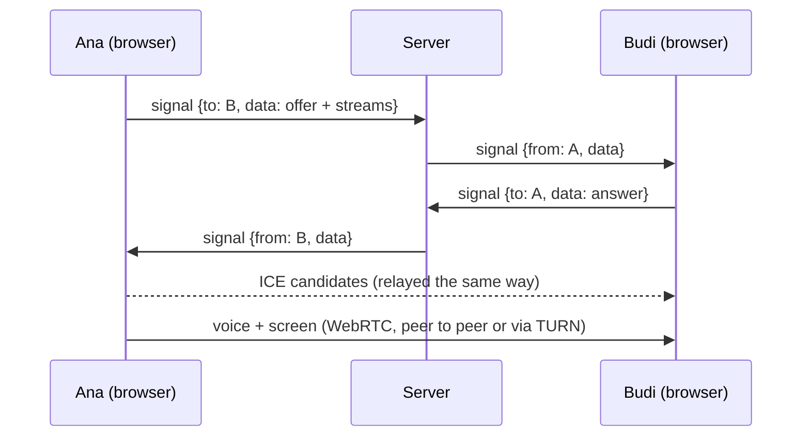

# Realtime protocol

One WebSocket per client at `/ws` (same origin; Vite proxies it in development). The protocol is
versioned (`NET.protocolVersion`, currently 3) and defined in `packages/shared/src/protocol`.
Every JSON message is validated with zod on both ends; the server never trusts the client.

- **JSON text frames** for events: `{ "t": "<type>", ... }`, at most `NET.maxMessageBytes` (64 KB,
  sized for WebRTC session descriptions).
- **Binary frames** for the 20 Hz traffic: fixed little-endian layouts, first byte is the opcode.

Voice and screen sharing travel peer to peer over WebRTC; the server only relays signaling and
arbitrates the presenter (see [Media](#media)).

## Session

1. Client opens the socket and sends `hello` (protocol version, room code or `null` for a fresh
   room, name, encoded `AvatarSpec`, optional passcode, optional `resume`).
2. Server answers `welcome` (own id, binary slot, resume token, room settings, everyone in the
   room, recent chat, server time, ICE servers) or `error` and closes with 4002.
3. Both sides stream: client `MOVE` frames, server `SNAPSHOT` frames and events.
4. A dropped connection keeps the member (seat, raised hand, presenter slot) for
   `NET.resumeGraceMs` (45 s). Others see `away`. Reconnecting with `hello.resume = { id, token }`
   restores the same session (`welcome.resumed = true`). Closing with code 4000 leaves for good.

A room is created by the first `hello` for its code (that person becomes host). With
`room: null` the server picks a fresh 6-character code. A passcode set on creation is stored as
an scrypt hash and checked with a constant-time compare.

## Binary frames

| Op           | Direction        | Layout (little-endian)                                                   |
| ------------ | ---------------- | ------------------------------------------------------------------------ |
| `1` MOVE     | client to server | op u8, seq u16, x/y/z f32, yaw u16, speed u8 (1/20 m/s), flags u8        |
| `2` SNAPSHOT | server to client | op u8, server time f64 (ms), count u16, then per player: slot u16 + pose |

Pose = x/y/z f32, yaw u16 (full turn / 65536), speed u8, flags (bit 0 grounded, bit 1 sprinting).
Snapshots carry only people who moved since the last one, plus a full keyframe every second.
Clients send `MOVE` at up to 20 Hz while their pose changes, and once more when they stop.

## Client to server

| `t`       | Fields                                      | Server rule                                                     |
| --------- | ------------------------------------------- | --------------------------------------------------------------- |
| `hello`   | `v, room, name, avatar, passcode?, resume?` | First message only                                              |
| `ping`    | `c` (client ms)                             | Answered with `pong` (clock sync)                               |
| `chat`    | `text`                                      | Sanitized, max 280 characters, 5 burst then 1/s                 |
| `act`     | `action` (emote or item use)                | Relayed to others, 2/s; Serious mode keeps `SERIOUS_ACTIONS`    |
| `react`   | `emoji` (one of `REACTION_EMOJIS`)          | Relayed to others (shares the `act` budget)                     |
| `hand`    | `raised`                                    | Timestamped by the server (orders the queue)                    |
| `sit`     | `seat`                                      | Granted if free and within 4 m, else `seatDenied`               |
| `stand`   |                                             | Frees the seat                                                  |
| `throw`   | `kind, from, to, target, n, tilt?`          | Not in Serious mode, when locked or while protected; near you   |
| `hit`     | `n, target`                                 | Thrower-reported: throw `n` from the last 5 s, once per throw   |
| `score`   | `n, hoop`                                   | Thrower-reported basket: a paper ball or duck from the last 6 s |
| `hold`    | `item` (a `HELD_ITEMS` id or null)          | Relayed to others                                               |
| `pickup`  | `owner, n` (a landed paper plane)           | Relayed to others; puts a plane in your hand                    |
| `shield`  | `on` ("Don't hit me")                       | Relayed to others                                               |
| `profile` | `name?, avatar?`                            | Name sanitized (24 characters)                                  |
| `host`    | `cmd` (see below)                           | Host only, else `error forbidden`                               |
| `signal`  | `to, data`                                  | Relayed as-is between two media peers of the room               |
| `voice`   | `muted, deafened`                           | Broadcast to the others when it changes                         |
| `present` | `on`                                        | Presenter arbitration, see [Presenter](#presenter)              |

Host commands: `mode`, `lockThrows`, `kick`, `lowerHand`, `transfer`, `voiceMode` (`global`,
`proximity`, `zones`), `muteAll` (a request to everyone else; clients comply, nobody's microphone
can be forced off), `stopShare` (ends whoever is presenting), `clean` (mops up every splat and
thrown object for everyone) and `resetScores`.

Movement is validated against a budget: on average at most sprint speed × `PLAYER.speedTolerance`
with a 2.5 m burst allowance, clamped to the room bounds. Longer jumps are clamped along the path,
so a teleporting client walks there quickly for everyone else. Seated players keep their seat
position.

## Server to client

| `t`              | Fields                                                                                      |
| ---------------- | ------------------------------------------------------------------------------------------- |
| `welcome`        | `v, self, slot, token, resumed, room, players, chat, now, ice`                              |
| `joined`         | `player`                                                                                    |
| `left`           | `id, reason` (`leave`, `timeout`, `kick`)                                                   |
| `away`           | `id, away`                                                                                  |
| `profile`        | `id, name, avatar`                                                                          |
| `seat`           | `seat, id` (null when freed)                                                                |
| `seatDenied`     | `seat`                                                                                      |
| `chat`           | `line { n, from, name, text, at }`                                                          |
| `act`            | `id, action`                                                                                |
| `react`          | `id, emoji`                                                                                 |
| `hand`           | `id, raised, at`                                                                            |
| `throw`          | `id, kind, from, to, target, n, tilt` (to everyone but the thrower)                         |
| `hit`            | `id, kind, target`                                                                          |
| `score`          | `id, hoop, points, total` (to everyone, the scorer included)                                |
| `hold`           | `id, item`                                                                                  |
| `pickup`         | `id, owner, n`                                                                              |
| `shield`         | `id, on`                                                                                    |
| `clean`          | `by` (the host mopped up; to everyone, the host included)                                   |
| `scoreReset`     | `by`                                                                                        |
| `room`           | `room { code, map, mode, throwsLocked, host, capacity, locked, voice, presenter, meshCap }` |
| `signal`         | `from, data`                                                                                |
| `voice`          | `id, muted, deafened`                                                                       |
| `presentRequest` | `from` (to the presenter: someone would like the screen)                                    |
| `muteRequest`    | `by` (the host asked everyone to mute)                                                      |
| `ice`            | `servers` (fresh TURN credentials before the old ones expire)                               |
| `pong`           | `c, s` (echoed client time, server time)                                                    |
| `error`          | `code, message?`                                                                            |

A player (`welcome.players`, `joined.player`) carries `id, name, avatar, slot, seat, hand, pos,
yaw, away, muted, deafened, since, held, shield, points`; `since` is the server time they joined,
`held` what is in their hand, `shield` their "Don't hit me" and `points` their hoop score in this
room. New members start muted.

Error codes: `version`, `full`, `passcode`, `invalid`, `rate`, `kicked`, `forbidden`, `notJoined`,
`busy` (someone else holds the presenter slot).

## Playful layer

The shared rules live in `packages/shared/src/protocol/play.ts`; the server side in
`apps/server/src/realtime/play-handlers.ts`.

- **Throw numbers.** Each client numbers its own throws (`n`, 0 to 65535, wrapping). `hit` and
  `score` name a throw by its number. The server remembers a member's last 24 throws (kind,
  time, release point) and accepts one hit per throw within 5 s and one basket per throw within
  `SCORE_WINDOW_MS` (6 s). Hits on yourself or on a protected person are dropped.
- **Paper planes** carry `tilt` (-1 banks left, 1 banks right). Every client plans the same
  glide from `from`, `to` and `tilt`, so a plane flies the same path everywhere. Other kinds
  always relay `tilt: 0`.
- **Baskets.** Paper balls and ducks score (`SCORING_KINDS`); the hoop is named by its prop id.
  Points come from the horizontal distance between the release point and the rim: 2, or 3 from
  `THREE_POINT_RANGE` (4.5 m) and beyond. The server keeps the total (`PlayerInfo.points`); it
  starts at zero for each room and the host's `resetScores` clears everyone's.
- **"Don't hit me"** (`shield`). A protected person does not throw (the server answers
  `error forbidden`); a throw aimed at them is relayed without its target, and clients let it pass
  through them with a shimmer instead of a hit.
- **Room modes.** Serious: no throws, and `act` only relays `SERIOUS_ACTIONS` (quiet gestures and
  using a held item). Casual: everything. Party: everything; clients add party lights, sparkle
  trails and confetti.
- **Held items** (`hold`): a mug, water, pizza, phone or one of four signs; `null` empties the
  hand. `pickup` takes someone's landed paper plane (`owner`'s throw `n`) off the floor for
  everyone and puts it in your hand. Pickups are cosmetic: only the rate limit applies.
- **Clean-up.** The host's `clean` reaches everyone, the host included, so all clients run the
  same mop-up: thrown objects vanish and splats fade in a wave from the host.

## Media

- **Who connects:** a full mesh between the room's media peers, the `meshCap` longest-present
  people (`mediaPeers` in `packages/shared/src/protocol/media.ts`: join time, then id). Server and
  clients apply the same rule, so they agree without extra messages. The server relays `signal`
  only between two media peers; anyone beyond the cap still chats, moves and sees the room, but
  has no voice or screen (an SFU transport would lift the cap).
- **Signal data** (`signalDataSchema`): `description` (`type`, `sdp` up to 40,000 characters),
  `candidate` (`null` = end of candidates) and `streams { mic, screen }`, which of the sender's
  stream ids carries the voice and which the screen, so receivers can tell them apart.
- **Negotiation:** perfect negotiation on every link (the peer with the larger id is polite),
  implicit `setLocalDescription`, rollback on glare. Tracks are attached once per link and swapped
  with `replaceTrack`: mute, device switches and new shares need no renegotiation. Opus DTX is on.
  Failed links restart ICE.
- **ICE servers:** `welcome.ice` and `ice` messages. Operators list STUN/TURN URLs in
  `HUDDLE_ICE_URLS`; there is no default public STUN server (privacy). TURN credentials use
  coturn's `use-auth-secret` scheme: username `<expiry unix seconds>:<member id>`, password
  base64(HMAC-SHA1(`HUDDLE_TURN_SECRET`, username)), valid for `HUDDLE_TURN_TTL_SECONDS`
  (default 3600) and refreshed at half that. They only travel over the authenticated WebSocket;
  there is no HTTP endpoint that hands them out. TURN URLs without a secret are not handed out.

### Presenter

One presenter at a time (`room.presenter`):

| Request `present on` from | Presenter now | Result                                                  |
| ------------------------- | ------------- | ------------------------------------------------------- |
| anyone                    | nobody        | Granted (`room` update)                                 |
| the host                  | someone else  | Taken over (`room` update; the old presenter stops)     |
| anyone else               | someone else  | `error busy` to them, `presentRequest` to the presenter |
| the presenter             | themselves    | Ignored                                                 |

`present off` from the presenter (or the host's `stopShare`, or the presenter leaving) frees the
screen. Clients capture first and publish the screen only once the room names them presenter;
someone asking for a handoff does not capture until the screen is free.

## Limits and close codes

- Per message type token buckets (burst, per second; see
  `apps/server/src/realtime/rate-limit.ts`): `signal` 400/120 (joining a full mesh negotiates with
  everyone at once), `voice` 10/4, `present` 6/1, `score` 6/2, `hold` and `pickup` 10/3,
  `shield` 4/1, plus a per-connection budget of 500 burst and 160 messages per second; sustained
  flooding closes with 4008.
- Concurrent sockets per IP: `HUDDLE_MAX_CONN_PER_IP` (64). Room capacity:
  `HUDDLE_ROOM_CAPACITY` (24, max 50). Mesh size: `HUDDLE_MESH_CAP` (8, max 16). Live rooms:
  `HUDDLE_MAX_ROOMS` (500).
- Foreign `Origin` headers are refused with 403 unless listed in `HUDDLE_ALLOWED_ORIGINS`.
- Close codes: 4000 leave, 4001 replaced by a resumed session, 4002 join rejected, 4003 kicked,
  4008 flooding. Dead connections are found by a 15 s WebSocket ping.

## HTTP endpoints

| Path               | Purpose                                        |
| ------------------ | ---------------------------------------------- |
| `GET /healthz`     | Liveness probe with room and connection counts |
| `GET /config.json` | Runtime client config (no secrets)             |
| `GET /ws`          | WebSocket upgrade for the realtime protocol    |

## Client behavior

- Remote players are drawn `NET.interpolationDelayMs` (100 ms) in the past, interpolating
  between snapshots; past the newest one they are extrapolated for at most 250 ms. Server time
  comes from an NTP-style offset over `ping`/`pong` (median of the faster half of 9 samples).
- The thrower's client simulates its throw and reports hits and baskets by throw number;
  everyone else replays the throw as a cosmetic projectile (it splats, bounces and swishes
  through the net the same way) and plays the flinch when the `hit` arrives.
- A fresh session (not a resume) tells the room what is in hand and whether "Don't hit me" is on.
- Reconnects back off exponentially (0.5 s doubling, up to 10 s, with jitter) and resume the
  session inside the grace window. `version`, `full`, `passcode` and `kicked` errors are final.
  Media links survive a resumed session; a fresh session (new id) builds new ones.
- People on other clients do not block local walking (their pose lags); throws still hit them.
- `voice` updates are spaced at least 300 ms apart (push-to-talk taps stay inside the limit); the
  last state always goes out.

## Load test

`pnpm bots -- --url ws://localhost:8787/ws --room SWARM1 --count 50 --seconds 30` spawns fake
clients that wander, emote and chat, then reports joins, errors, snapshots and ping. Start the
server with `HUDDLE_ROOM_CAPACITY=50` for 50 bots in one room. The same swarm (50 clients) runs
in `pnpm test`. Bots have no WebRTC: if they joined first they take mesh places.
